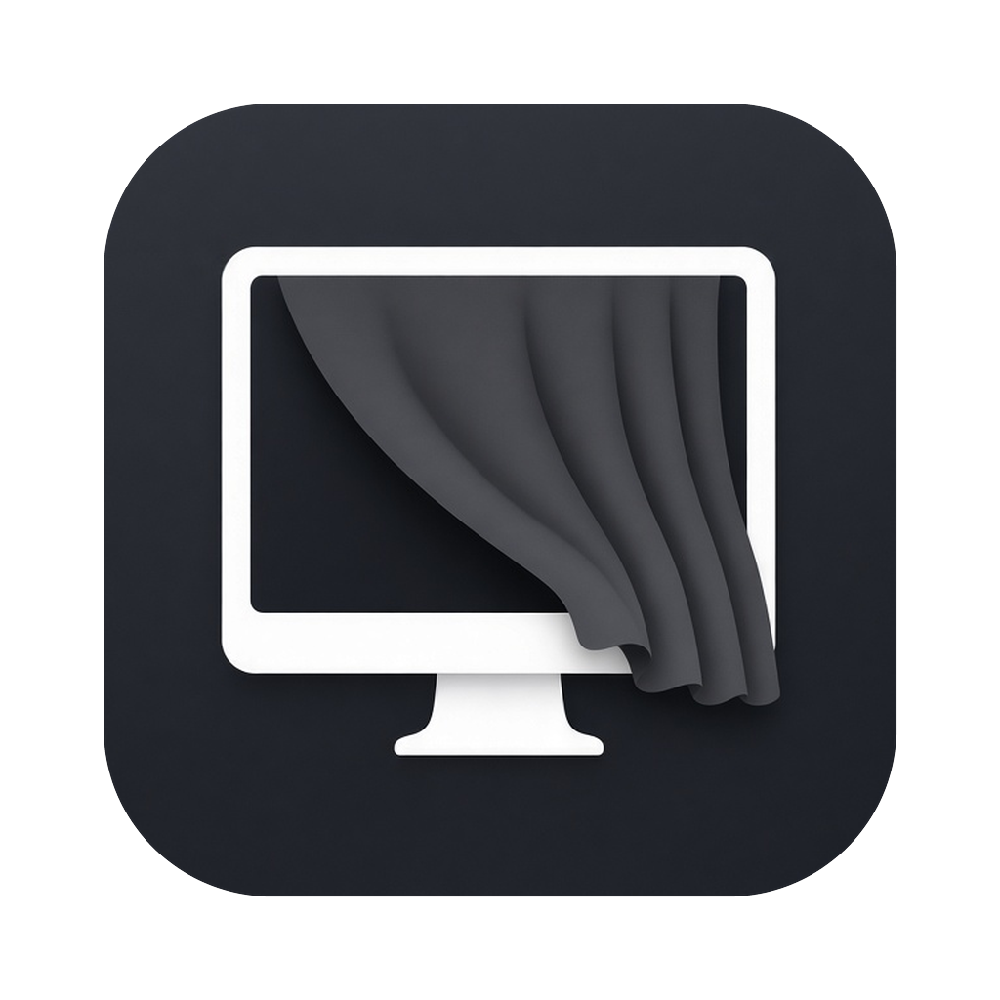

# Shade



Turn any display off without unplugging it. One click, one hotkey, and you can never lock yourself out.

Shade is a free, open-source macOS menu bar app that switches individual displays off and back on. It is handy for turning off a MacBook's built-in screen while it's docked with the lid open, or for blanking a monitor you aren't using.

## Features

- **Per-display toggle.** Turn any connected display off or on from the menu bar.
- **Off displays stay listed**, so you can turn them back on with one click.
- **Turn All On** brings every display back at once.
- **Global hotkey:** `Ctrl` + `Option` + `Cmd` + `B` turns all non-main displays off or on.
- **Per-display hotkeys:** `Ctrl` + `Option` + `Cmd` + `1` to `9` switch display 1 to 9, in the order the menu lists them.
- **Auto mode (optional):** Built-in Off When External Connects turns the MacBook screen off when you plug in a monitor. Unplug the monitor and the built-in screen comes back on.
- **Command line and Shortcuts:** `Shade list`, `Shade off 2`, `Shade on 2` and more. See [Command line](#command-line).
- **Monitor volume (optional):** volume keys, and knobs that send them, change your external monitor's own volume over DDC. There's also a slider in the menu. See [Monitor volume](#monitor-volume).
- **Launch at login** (uses `SMAppService`).
- **Back on at wake.** All displays are turned on again when your Mac wakes from sleep.
- **Can't lock you out.** Shade won't turn off your last active display.
- **Restores on exit.** Quitting Shade, or stopping it with `kill`, Ctrl-C or a logout, turns every display back on.
- **Recovers from crashes.** If Shade crashes or is force-killed while a display is off, it turns everything back on the next time it starts, including at login after a reboot.
- **Watches for trouble.** If displays change and nothing is left on, Shade turns them all back on.
- **Update check.** Once a day Shade asks GitHub whether there's a newer release and shows "Update Available" in the menu. It never downloads or installs anything. Turn it off with Check for Updates Daily.
- **Fails safe.** If a macOS update removes the display API, Shade shows "Unsupported on this macOS" instead of crashing, and Turn All On still shows.

## Install

Requires macOS 13 or later. Shade is a universal app for Apple silicon and Intel Macs, but it has only been tested on Apple silicon so far.

### Homebrew

```sh
brew install --cask peteoco/tap/shade
```

The cask comes from a personal tap, `peteoco/homebrew-tap`. Because Shade isn't notarized, the cask removes the quarantine flag after installing so the app opens normally.

### Download

1. Download the latest `Shade.zip` from [Releases](../../releases).
2. Unzip it and move `Shade.app` to `/Applications`.
3. Open it. A Shade icon appears in the menu bar.

### Opening an unsigned app

Shade isn't notarized yet, so Gatekeeper blocks it the first time you open it. You can get past this in any of these ways:

- **Right-click (or Control-click) `Shade.app` in Finder, choose Open, then click Open in the dialog.**
- Or try to open it once, then go to **System Settings > Privacy & Security**, scroll down, and click **Open Anyway**.
- Or remove the quarantine flag in Terminal:

  ```sh
  xattr -dr com.apple.quarantine /Applications/Shade.app
  ```

You only have to do this once.

## Build from source

You need the Xcode Command Line Tools (`xcode-select --install`).

```sh
git clone https://github.com/peteoco/shade.git
cd shade
./build.sh
```

`build.sh` compiles `main.swift` and packages `Shade.app` with `AppIcon.icns`.

## Command line

The app binary doubles as a command-line tool:

```sh
S=/Applications/Shade.app/Contents/MacOS/Shade
$S list          # numbered displays, on/off, main, UUID
$S off 2         # turn display 2 off (refuses the last active display)
$S on 2
$S toggle 2
$S others        # same as Ctrl-Option-Cmd-B
$S all-on        # same as --rescue
$S volume        # read the external monitor's volume, e.g. 50/100
$S volume 30     # set it
```

You can pass a display's UUID instead of its number. To use Shade from **Shortcuts** or a Stream Deck, add a Run Shell Script action with one of these commands.

## Monitor volume

macOS can't change the volume of sound sent to a monitor over DisplayPort or HDMI, so the volume keys do nothing. Shade can ask the monitor to change its own volume instead, over DDC/CI.

1. In the Shade menu, turn on **Monitor Volume Keys**.
2. When macOS asks, give Shade Accessibility permission in System Settings > Privacy & Security > Accessibility. Shade needs it to catch the volume keys.
3. The volume up, down and mute keys now change the monitor's volume, but only while your sound output is a DisplayPort or HDMI monitor. Speakers and headphones work as before.

Notes:

- This works on Apple silicon Macs only. It uses Apple's private `IOAVService` calls, the same way [MonitorControl](https://github.com/MonitorControl/MonitorControl) does.
- Your monitor needs DDC/CI turned on in its own menu, and some monitors don't support volume over DDC at all.
- With more than one external monitor, Shade controls the first one it finds.
- Because Shade is ad-hoc signed, macOS may ask for Accessibility permission again after each update.
- macOS doesn't show its volume overlay for these changes. The menu slider shows the level.

## Safety

Shade is built so you never get stuck with a black screen:

- It won't turn off the last display that's still on.
- Every display comes back on when your Mac wakes.
- **Turn All On** and the hotkey restore your displays at any time.

If something goes wrong, unplugging and reconnecting a display, or restarting your Mac, also turns it back on.

## Rescue

If you ever can't see a screen:

1. Press `Ctrl` + `Option` + `Cmd` + `B`. If any display is off, this turns them all back on.
2. Or, from Terminal or over SSH from another machine, run:

   ```sh
   /Applications/Shade.app/Contents/MacOS/Shade --rescue
   ```

   It turns every display on and exits. It works even when the menu bar app isn't running.
3. Or restart your Mac. Displays come back on at login.

Shade keeps a small file at `~/Library/Application Support/Shade/disabled.json` while any display is off. It's how Shade knows to recover after a crash, and it's deleted when everything is back on.

## Logs

Shade logs every display change, wake, signal and update check to the system log:

```sh
log show --last 1h --predicate 'subsystem == "com.peteoconnell.shade"' --info
```

Please include this output when you report a bug.

## Private API caveat

To turn displays off, Shade calls `CGSConfigureDisplayEnabled`, a private macOS API that Apple doesn't document. Other display utilities use the same call. Because the API is private:

- A macOS update could change it or break it.
- Shade can't be sold in the Mac App Store.
- Results can differ between Apple silicon and Intel Macs, and between display setups.

If something breaks after an update, please [open an issue](../../issues) and include your Mac model and macOS version.

## License

[MIT](LICENSE) © 2026 Peter O'Connell
